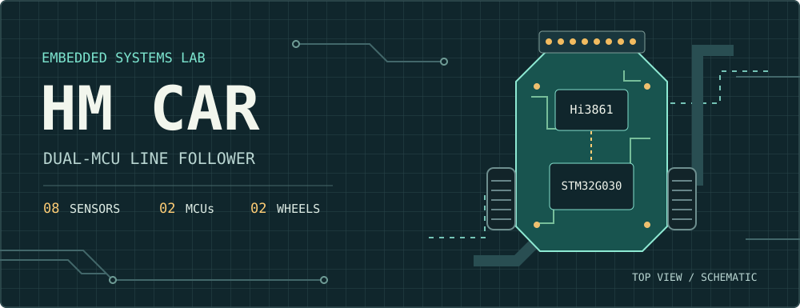
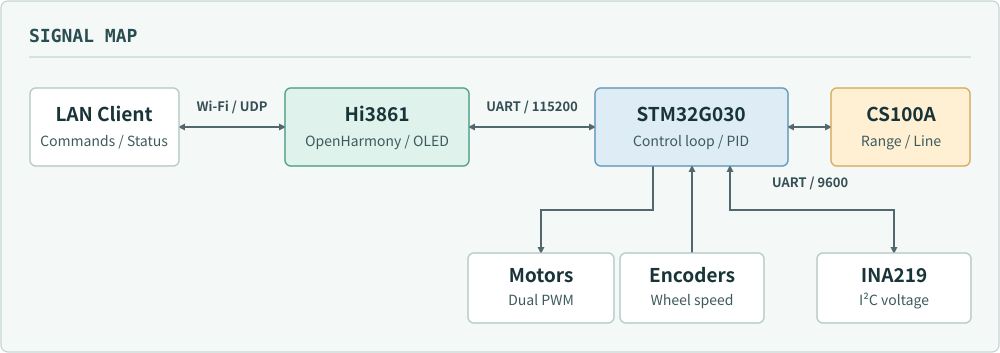

<div align="center">

# HM Car · 双控制器循迹智能车

**从八路光电读数，到两轮差速闭环。**




[系统架构](#系统架构) · [核心功能](#核心功能) · [快速开始](#快速开始) · [仓库导航](#仓库导航) · [资料与许可](#资料与许可)

</div>

HM Car 是一个面向实体小车的嵌入式工程。Hi3861 负责上位通信和状态显示，STM32G030 负责实时电机与传感器处理。即使不接入上位通信，也可以从 STM32 工程入手，追踪一笔循迹数据如何转成左右轮的目标速度。

## 系统架构



| 模块 | 职责 | 源码入口 |
| --- | --- | --- |
| Hi3861 · 上位系统 | Wi-Fi / UDP 转发、OLED 状态显示、板间通信 | [小车示例](Go_Car_V1/Up_system/src/vendor/hqyj/fs_hi3861/demo/smartCar_uart_udp/) |
| STM32G030F6Px · 下位系统 | UART 数据处理、编码器测速、双轮 PWM / PID、循迹 | [程序入口](Go_Car_V1/Down_system/Core/Src/main.c) · [电机控制](Go_Car_V1/Down_system/Core/Src/app_motor.c) |
| CS100A · 传感器模块 | 上报超声测距与八路光电循迹数据 | [下位机帧处理](Go_Car_V1/Down_system/Core/Src/stm32g0xx_it.c) |
| INA219 · 电压采样 | 下位机通过 I²C 读取总线电压 | [采样驱动](Go_Car_V1/Down_system/Core/Src/bsp_ina219.c) |

上位机与电机板的示例串口速率为 **115200 baud**；电机板与传感器的 USART2 为 **9600 baud**。两路均为 **8N1**，详见 [USART 配置](Go_Car_V1/Down_system/Core/Src/usart.c)。架构图用于阅读源码，不是接线图。

## 核心功能

| 能力 | 实现 |
| --- | --- |
| 八路循迹 | `bit0` 至 `bit7` 从左到右，低电平表示检测到黑线；固件按激活位置加权估计偏差，调整内、外轮速度。 |
| 直角弯与丢线处理 | 电机代码包含原地转向、记忆上次线的位置、找线及转向超时保护。 |
| 双轮闭环 | 编码器提供速度反馈，增量式 PID 调节左右轮 PWM。 |
| 采集与状态反馈 | STM32 接收测距及循迹帧，并将距离、电池电压、速度字段封装成 JSON；Hi3861 小车示例提供 UDP 与 OLED 任务。 |
| 串口诊断 | Windows 下可直接运行 Python 脚本查看串口反馈，无需安装 `pyserial`。 |

<details>
<summary>展开：传感器帧与循迹处理</summary>

```text
CS100A 四字节帧
  0xAA | 八路位图 | 循迹类型 | 校验和  ->  位置估计 -> 差速 / 转向
  0xFF | 距离高位 | 距离低位 | 校验和  ->  距离更新 -> 状态上报
```

末字节是前三个字节之和的低 8 位。以上是 STM32 接收端实现，不应拿传感器串口帧代替上位机的 JSON 命令。

</details>

## 快速开始

用较短的 Windows 路径克隆，避免 SDK 深层路径影响开发工具：

```powershell
git -c core.longpaths=true clone https://github.com/yuhuang007/HM_Car.git D:\HMCar
cd D:\HMCar
```

### 1. 编译 STM32 下位机

1. 使用 Keil MDK 打开 [FS-Hi3861-Motor-Driver.uvprojx](Go_Car_V1/Down_system/MDK-ARM/FS-Hi3861-Motor-Driver.uvprojx)。工程目标是 `STM32G030F6Px`，配置使用 `Keil.STM32G0xx_DFP.1.4.0`。
2. 安装对应设备支持包，执行 **Rebuild**，使用实际板卡支持的调试器下载。使用 [CubeMX 工程](Go_Car_V1/Down_system/FS-Hi3861-Motor-Driver.ioc) 查看引脚、DMA 和定时器配置；重生成前留存现有应用代码。
3. 首次联调先架空车轮，核对电源、共地、串口电平和电机方向，再进行低速测试。

### 2. 编译 Hi3861 上位机

1. 准备 DevEco Device Tool 或 Hi3861V100 工具链，从 [上位系统说明](Go_Car_V1/Up_system/README.md#快速上手) 查找环境安装和烧录步骤。
2. 在工具链命令行进入 `Go_Car_V1/Up_system/src`，运行 `hb set`，为华清远见板选择 `hqyj_fs_hi3861` 产品。已有 DevEco 用户可导入 `Go_Car_V1/Up_system` 并配置本机工具链路径和串口。
3. 在 [FS-Hi3861 示例选择文件](Go_Car_V1/Up_system/src/vendor/hqyj/fs_hi3861/demo/BUILD.gn) 中启用 `smartCar_uart_udp:smartCar_demo`，同时关闭已选的其他示例，然后运行 `hb build`。历史副本的默认示例并非小车 UDP，不能直接沿用默认产品和示例设置。
4. 使用与板卡匹配的工具烧录。该示例通过 NFC 配网，联调请使用隔离的测试网络；没有配套控制端时可先观察 OLED 和串口日志。

### 3. 查看串口反馈

连接 Hi3861 调试 USB，关闭占用同一 COM 口的终端，再在仓库根目录运行：

```powershell
python .\My_Study\serial_diag\serial_diag.py
```

按提示选择端口。当前脚本以 **115200 baud** 连接，适合 Windows 本地诊断。仓库发布不等于已完成板上验证；烧录前仍需按硬件手册核对接线与供电。

## 仓库导航

```text
HM_Car/
├── Go_Car_V1/
│   ├── Down_system/       STM32 固件、HAL / CMSIS、Keil 和 CubeMX 工程
│   ├── Up_system/         Hi3861 OpenHarmony SDK、板级示例与上游教程
│   └── _apply.py          历史迁移脚本，不是构建入口
├── My_Study/
│   ├── CS_yuanma/         学习用 SDK 快照，含不同的示例选择
│   └── serial_diag/       Windows 串口诊断脚本
└── docs/                  首页配图、开发资料索引与发布范围
```

## 资料与许可

- [开发资料与发布范围](docs/resources.md)：原目录对照、工具来源与未随仓库上传的内容。
- [上游 SDK 许可](Go_Car_V1/Up_system/LICENSE) · [OpenHarmony NOTICE](Go_Car_V1/Up_system/src/NOTICE) · [STM32 HAL 许可](Go_Car_V1/Down_system/Drivers/STM32G0xx_HAL_Driver/LICENSE.txt)。
- 该仓库未新增覆盖所有组件的统一许可证；第三方源码、SDK 和资料分别遵循原授权。首页的两张图是按源码绘制的示意图，不是实车照片或电气接线图。
